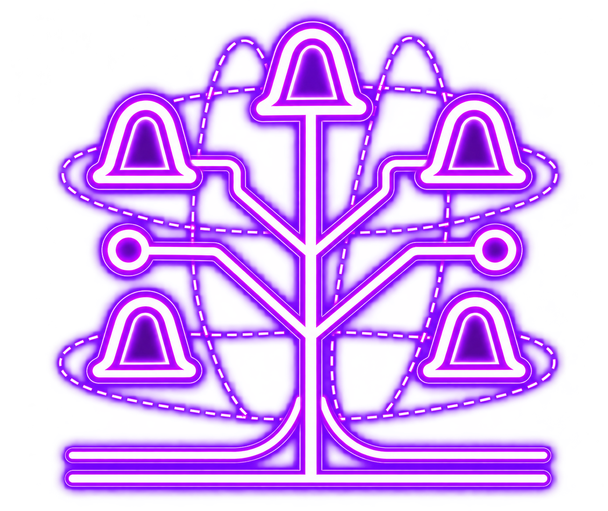

<p align="center">
  
</p>

<h1 align="center">fliXer</h1>

<p align="center">
  Governs LLMs logic flow following constrained rules; transforms semantic states into inferential states.
</p>


> 🚧 **Under Active Development**
>
> This module is currently under active development. Its architecture, features, and documentation are evolving and may change as research and implementation progress. **Not yet recommended for production use**.

## Overview

fliXer explores how explicit logical structures, constraints, and inference checks can complement probabilistic language-model generation. It is part of [The Glass Box AI Project](https://glassboxai.dev/) and the experimental NeXis architecture.

The central research question is: **Can separating language generation from inspectable logical validation make contradictions and unsupported inferences easier to detect and explain?**

## Architectural concept

fliXer investigates the transformation of relevant semantic content into representations suitable for explicit inference and constraint checking. A conceptual processing sequence is:

1. Receive candidate statements or structured semantic information.
2. Identify propositions, relations, and constraints that can be represented explicitly.
3. Evaluate consistency and applicable inference rules within the available formal representation.
4. Produce inspectable validation outcomes, including unresolved or unsupported cases.
5. Return structured feedback to the consuming AI system or human reviewer.

```text
        Generated statements / semantic information
                            |
                            v
              Proposition extraction
                            |
                            v
          Explicit rules and constraints
                            |
                            v
             Consistency / inference checks
                            |
                            v
          Findings + evidence + uncertainty
                            |
                            v
                  Human / AI review
```

The diagram is conceptual. The choice of formalism, rule engine, semantics, and integration interface remains subject to implementation documentation and validation.

## Research objectives

- Separate probabilistic generation from explicit logical assessment.
- Detect contradictions relative to stated premises and available rules.
- Make validation decisions and their assumptions inspectable.
- Distinguish a detected contradiction from an unverified or undecidable claim.
- Explore feedback mechanisms for revision or human review.

## Important distinction

**Logical consistency is not factual truth.** A statement may be consistent with a set of premises while being false in the real world. Conversely, an apparent contradiction may arise from missing context, ambiguous language, or incorrect proposition extraction. fliXer is therefore intended as a potential validation component, not an infallible truth detector.

## Evaluation plan

Potential experiments include contradiction-detection benchmarks, rule-consistency tasks, controlled synthetic reasoning problems, and evaluations of false-positive and false-negative rates. Important measurements include extraction accuracy, soundness relative to an explicitly defined formalism, coverage, explainability, and computational cost.

**No validated performance results are published in this repository at present.**

## Relationship to NeXis

Within the experimental NeXis architecture, [aXiom](https://github.com/glassboxai/aXiom) explores knowledge activation, [veXtor](https://github.com/glassboxai/veXtor) explores semantic guidance during decoding, and fliXer explores logical validation. Their combination is a research direction and should not be understood as a verified end-to-end system.

## Availability and roadmap

This repository currently provides a public description of the research direction. Future materials may include a formal problem specification, prototype code, tests, benchmark definitions, and reproducible experimental reports. No publication timeline is guaranteed.

## Limitations

Natural-language-to-logic translation can introduce errors; rule sets can be incomplete or inconsistent; some statements cannot be decided from available evidence. Results must be interpreted within the declared assumptions and scope of the validation method.

## Project

- [The Glass Box AI Project](https://glassboxai.dev/)
- [Glass Box AI on GitHub](https://github.com/glassboxai)

## License

This repository is licensed under **AGPL-3.0**. See [LICENSE](LICENSE). Any future source-code release will identify its applicable license and third-party dependencies.


